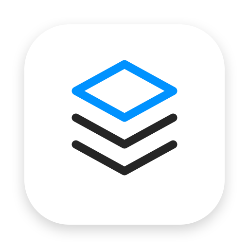

<p align="center">
  
</p>

<h1 align="center">ClipStack</h1>

<p align="center">**English** · [Español](README.es.md)</p>

A **free and open-source** clipboard manager for macOS.
ClipStack remembers everything you copy (text, images, files and screenshots)
and lets you paste any earlier item with a keyboard shortcut.

## ⬇️ Download

**With Homebrew** (recommended):

```bash
brew install --cask zh0du/tap/clipstack
```

**Or manually:** **[download ClipStack.dmg](https://github.com/Zh0du/clipstack/releases/latest/download/ClipStack.dmg)**. You don't need to build anything.

1. Open `ClipStack.dmg` and drag **ClipStack** into **Applications**.
2. Open ClipStack from Applications. A 📋 icon appears in the menu bar.
3. The first time, macOS may say the app "can't be opened" because it isn't signed
   with a paid Apple Developer certificate. Go to **System Settings → Privacy & Security**,
   scroll down and click **Open Anyway**.
   Or run this in Terminal:
   ```bash
   xattr -dr com.apple.quarantine /Applications/ClipStack.app
   ```
4. Grant **Accessibility** permission when asked (see [Permissions](#permissions)).

All versions are on the [Releases](https://github.com/Zh0du/clipstack/releases) page.

## Features

- 📋 History of everything you copy: text, images and files.
- 📸 Screenshots included:
  - `⌃⇧⌘3` / `⌃⇧⌘4` (screenshot to clipboard), and
  - `⇧⌘3` / `⇧⌘4` / `⇧⌘5` (screenshots saved as files, detected through Spotlight).
- ⌨️ Global shortcut **`⇧⌘V`** opens the history. You can change it to `⌃⌘V`, `⌃⇧⌘V` or `⌥⌘V`.
- 🔎 Type to search.
- Move with `↑` `↓` and press `↩` to paste, or **click** an item.
- `⌘1`…`⌘9` paste one of the first 9 items directly.
- `⌘⌫` deletes the selected item, `esc` closes the panel.
- 🌍 Available in **English, 简体中文 (Chinese), हिन्दी (Hindi) and Español**. Change it from the menu → *Language*.
- History survives restarts.
- Skips passwords copied from password managers (1Password, Bitwarden, etc.).
- Lives in the menu bar, with no Dock icon.

## Requirements

macOS 13 (Ventura) or later, on Apple Silicon or Intel.

## Permissions

- **Accessibility** (System Settings → Privacy & Security → Accessibility):
  ClipStack needs it to paste automatically (it simulates `⌘V`).
  Without it, the item you pick is copied to the clipboard and you press `⌘V` yourself.
- **Desktop / Documents**: macOS asks the first time so ClipStack can read
  screenshots saved as files.

## Privacy

Everything stays on your Mac, in `~/Library/Application Support/ClipStack/`
(`history.json` plus images in `images/`). ClipStack never connects to the internet.

## About `⇧⌘V`

Some apps use `⇧⌘V` for "Paste and Match Style". While ClipStack is running,
the shortcut opens the history instead. You can change it from the menu → *Keyboard shortcut*.

## Building from source

You need Xcode or the Command Line Tools (`xcode-select --install`).

```bash
git clone https://github.com/Zh0du/clipstack.git
cd clipstack
./scripts/build-app.sh --dmg      # creates build/ClipStack.app and build/ClipStack.dmg
```

For development: `swift run`.

### Publishing a new version

Push a version tag. GitHub Actions builds the installer and attaches it to a new release:

```bash
git tag v1.0.0
git push origin v1.0.0
```

### Adding a language

All strings live in `Sources/ClipStack/Localization.swift`. Add a case to `AppLanguage`,
add a translation for each key, and add a `Resources/<code>.lproj/InfoPlist.strings`.
Pull requests are welcome!

## Author

Made by **Zh0du**

- GitHub: [@Zh0du](https://github.com/Zh0du)

If ClipStack is useful to you, give the repo a ⭐.

## License

[MIT](LICENSE). Free to use, modify and share.
